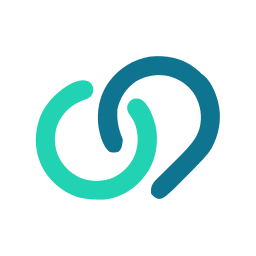
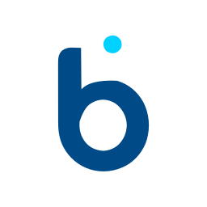
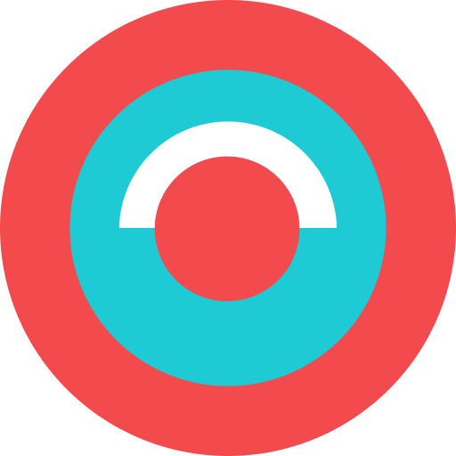
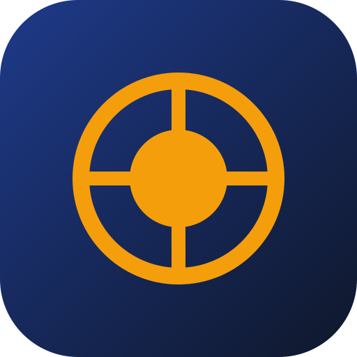
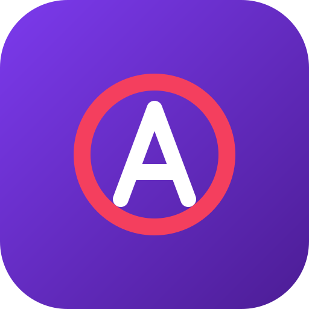
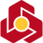
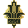
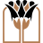
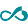

# IranianBanks

> **Modern directory of Iranian Banks and Neo-banks with authentic vector SVG and high-resolution PNG logos, card BIN prefixes, SHEBA ISO 7064 validation, and single-file client libraries for JavaScript, Python, and PHP.**

[](https://mehrnet.github.io/IranianBanks/)
[](LICENSE)
[](#covered-banks--neo-banks)

---

## Features

- **Up-to-date Database**: Covers all 30+ official Central Bank of Iran (CBI) banks as well as latest modern neo-banks (**WePod**, **BluBank**, **Banket**, **Bankino**, **Tobank**, **Omidbank**, **Abank**).
- **Authentic Logos**: Clean standalone vector **SVG** (`logos/svg/`) and multi-size transparent **PNG** (`logos/png/` in 32x32, 64x64, 128x128, 256x256, 512x512).
- **Client-Side Detection**: Automatic detection by 6-digit or 8-digit card BIN prefixes (e.g., differentiates BluBank `62198618` from Saman `621986`).
- **SHEBA (IBAN) Support**: Parses the 3-digit CBI bank code from Iranian IBANs (`IRxx...`).
- **Validation Algorithms**:
  - **Luhn Checksum** for 16-digit debit/credit cards.
  - **ISO 7064 Mod 97-10** for 26-character Iranian IBANs (SHEBA).
- **Zero-Dependency Single-File Libraries**:
  - `lib/iranian-banks.js` (Vanilla JS, Node.js, TypeScript, Browser)
  - `lib/iranian-banks.py` (Python 3.7+)
  - `lib/iranian-banks.php` (PHP 7.4+)
- **Interactive Showcase**: Hostable directly via **GitHub Pages** from the root `/` directory.

---

## Repository Structure

```
IranianBanks/
├── index.html                 # Interactive showcase & documentation (GitHub Pages root)
├── style.css                  # Responsive dark-theme styling
├── data/
│   └── banks.json             # Canonical JSON directory of all institutions
├── logos/
│   ├── svg/                   # 37 Optimized standalone vector SVG logos
│   └── png/                   # Transparent PNG logos in multiple sizes
│       ├── 32x32/             # 32px icons
│       ├── 64x64/             # 64px icons
│       ├── 128x128/           # 128px icons
│       ├── 256x256/           # 256px icons
│       └── 512x512/           # 512px hi-res icons
├── lib/
│   ├── iranian-banks.js       # Single-file JavaScript/TypeScript library
│   ├── iranian-banks.py       # Single-file Python library
│   └── iranian-banks.php      # Single-file PHP library
└── README.md
```

---

## Quick Start

### 1. JavaScript / TypeScript

```javascript
const { detect, isValidCard, isValidSheba, detectCard } = require('./lib/iranian-banks.js');

// 1. Live autodetect (Card or SHEBA)
const result = detect('5022291234567890');
console.log(result.bank.name_fa); // "ویپاد (ترابانک پاسارگاد)"
console.log(result.bank.color);   // "#0E7490"
console.log(result.valid);        // true (Luhn check passed)

// 2. SHEBA detection
const shebaResult = detect('IR020120000000000000000001');
console.log(shebaResult.bank.name_fa); // "بانک ملت"
```

### 2. Python

```python
import iranian_banks as ib

# Autodetect by Card or SHEBA
res = ib.detect('6219861812345678')
print(res['bank']['name_fa']) # 'بلوبانک (نئوبانک سامان)'
print(res['valid'])           # True
```

### 3. PHP

```php
<?php
require_once __DIR__ . '/lib/iranian-banks.php';
use MehrNet\IranianBanks;

 = IranianBanks::detect('5022291234567890');
echo ['bank']['name_fa']; // ویپاد (ترابانک پاسارگاد)
echo ['valid'] ? 'Valid' : 'Invalid';
```

---

## Covered Banks & Neo-banks

| Logo | Institution | Type | BIN Prefix | SHEBA Code |
| :---: | :--- | :---: | :---: | :---: |
| <a href="logos/svg/wepod.svg"></a> | **ویپاد (ترابانک پاسارگاد) (WePod)** | Neo-bank | `502229` | `057` |
| <a href="logos/svg/blubank.svg"></a> | **بلوبانک (نئوبانک سامان) (BluBank)** | Neo-bank | `62198618`, `62198619` | `056` |
| <a href="logos/svg/bankino.svg"></a> | **بانکینو (نئوبانک خاورمیانه) (Bankino)** | Neo-bank | `505785` | `078` |
| <a href="logos/svg/banket.svg"></a> | **بانکت (نئوبانک مهر ایران) (Banket)** | Neo-bank | — | `060` |
| <a href="logos/svg/tobank.svg"></a> | **توبانک (نئوبانک گردشگری) (Tobank)** | Neo-bank | — | `064` |
| <a href="logos/svg/omidbank.svg"></a> | **امیدبانک (بانک دیجیتال سپه) (Omid Bank)** | Neo-bank | — | `015` |
| <a href="logos/svg/abank.svg"></a> | **آبانک (بانک دیجیتال آینده) (Abank)** | Neo-bank | — | `062` |
| <a href="logos/svg/cbi.svg"></a> | **بانک مرکزی جمهوری اسلامی ایران (Central Bank of Iran (CBI))** | Central Bank | — | `010` |
| <a href="logos/svg/melli.svg"></a> | **بانک ملی ایران (Bank Melli Iran)** | Bank | `603799`, `170019` | `017` |
| <a href="logos/svg/sepah.svg"></a> | **بانک سپه (Bank Sepah)** | Bank | `589210`, `627381`, `639599`, `504172`, `627760` | `015` |
| <a href="logos/svg/mellat.svg"></a> | **بانک ملت (Bank Mellat)** | Bank | `610433`, `991975` | `012` |
| <a href="logos/svg/saderat.svg"></a> | **بانک صادرات ایران (Bank Saderat Iran)** | Bank | `603769`, `903769` | `019` |
| <a href="logos/svg/tejarat.svg"></a> | **بانک تجارت (Tejarat Bank)** | Bank | `585983`, `627353` | `018` |
| <a href="logos/svg/keshavarzi.svg"></a> | **بانک کشاورزی (Agri Bank (Keshavarzi))** | Bank | `603770`, `639217` | `016` |
| <a href="logos/svg/maskan.svg"></a> | **بانک مسکن (Bank Maskan)** | Bank | `628023` | `014` |
| <a href="logos/svg/refah.svg"></a> | **بانک رفاه کارگران (Refah Bank)** | Bank | `589463` | `013` |
| <a href="logos/svg/pasargad.svg"></a> | **بانک پاسارگاد (Bank Pasargad)** | Bank | `639347`, `502229` | `057` |
| <a href="logos/svg/saman.svg"></a> | **بانک سامان (Saman Bank)** | Bank | `621986` | `056` |
| <a href="logos/svg/parsian.svg"></a> | **بانک پارسیان (Parsian Bank)** | Bank | `622106`, `639194`, `627884` | `054` |
| <a href="logos/svg/eghtesad-novin.svg"></a> | **بانک اقتصاد نوین (Eghtesad Novin Bank)** | Bank | `627412` | `055` |
| <a href="logos/svg/karafarin.svg"></a> | **بانک کارآفرین (Karafarin Bank)** | Bank | `627488`, `502910` | `053` |
| <a href="logos/svg/sina.svg"></a> | **بانک سینا (Sina Bank)** | Bank | `639346` | `059` |
| <a href="logos/svg/sarmayeh.svg"></a> | **بانک سرمایه (Sarmayeh Bank)** | Bank | `639607` | `058` |
| <a href="logos/svg/shahr.svg"></a> | **بانک شهر (Shahr Bank)** | Bank | `502806`, `504706` | `061` |
| <a href="logos/svg/dey.svg"></a> | **بانک دی (Day Bank)** | Bank | `502938` | `066` |
| <a href="logos/svg/ayandeh.svg"></a> | **بانک آینده (Ayandeh Bank)** | Bank | `636214` | `062` |
| <a href="logos/svg/gardeshgari.svg"></a> | **بانک گردشگری (Tourism Bank (Gardeshgari))** | Bank | `505416`, `505426` | `064` |
| <a href="logos/svg/iran-zamin.svg"></a> | **بانک ایران زمین (Iran Zamin Bank)** | Bank | `505785` | `069` |
| <a href="logos/svg/khavarmianeh.svg"></a> | **بانک خاورمیانه (Middle East Bank)** | Bank | `585947` | `078` |
| <a href="logos/svg/mehr-iran.svg"></a> | **بانک قرض‌الحسنه مهر ایران (Qarz Al-Hasaneh Mehr Iran Bank)** | Bank | `606373` | `060` |
| <a href="logos/svg/resalat.svg"></a> | **بانک قرض‌الحسنه رسالت (Resalat Qarz Al-Hasaneh Bank)** | Bank | `504172` | `070` |
| <a href="logos/svg/post.svg"></a> | **پست بانک ایران (Post Bank Iran)** | Bank | `627760` | `021` |
| <a href="logos/svg/tosee-taavon.svg"></a> | **بانک توسعه تعاون (Tosee Taavon Bank)** | Bank | `502908` | `051` |
| <a href="logos/svg/tosee-saderat.svg"></a> | **بانک توسعه صادرات ایران (Export Development Bank of Iran (EDBI))** | Bank | `627648`, `207177` | `020` |
| <a href="logos/svg/sanat-madan.svg"></a> | **بانک صنعت و معدن (Bank of Industry and Mine)** | Bank | `627961` | `022` |
| <a href="logos/svg/melal.svg"></a> | **موسسه اعتباری ملل (Melal Credit Institution)** | institution | `606256` | `075` |
| <a href="logos/svg/noor.svg"></a> | **موسسه اعتباری نور (Noor Credit Institution)** | institution | `507677` | `080` |

---

## License

Released under the [MIT License](LICENSE). Maintained by [MehrNet](https://mehrnet.com).
